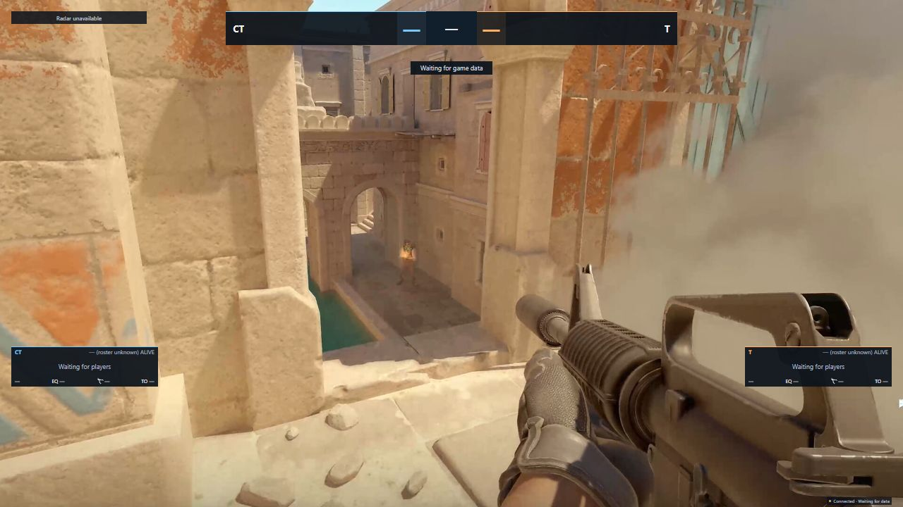

# sOU Default HUD · Blazor WebAssembly

Maintainers: [configure automatic sOU Creator uploads](docs/sou-upload.md).
Only the `SOU_CREATOR_API_KEY` repository secret is needed. Future published tags
upload automatically; the manual **Upload release to sOU** workflow also accepts
existing release tags without rebuilding their immutable packages. Uploads await sOU review.

A public C#/Blazor WebAssembly reference project for a complete CS2 broadcast: live HUD, prematch, real lineups, map veto, break, results, statistics and player spotlight. Modular components consume the published **SOU.Hud.Sdk** and **SOU.Live.Contracts** NuGet packages `0.2.0-preview.4`; no private application source is required.

The current source imports 81 weapon, grenade, status and killfeed SVGs from [JohnTimmermann/OpenHud-React-Hud](https://github.com/JohnTimmermann/OpenHud-React-Hud/tree/b2c1cedc4f03e0a1df86c9be6f9794ce0a7f8cc0). Dedicated skull and burning symbols replace the previous status art. Symbols absent from that reference retain their existing local assets; radar artwork is unchanged. Artwork remains unchanged, with newly measured optical sizing; Flashbang adds a missing SVG namespace for standalone browser loading. See [source and license details](LICENSES/OPENHUD-ICONS.md). These changes ship in 0.4.11; previous release packages remain unchanged.

Unavailable player portraits now use local CS2 agent placeholders: a distinct agent for every observer digit 0–9 on each side, with CT-only and T-only selections. Supplied portraits take priority, including newly arriving images; failed portraits also fall back. Side changes update the agent. Unknown sides or missing/invalid observer slots keep the existing final fallback. These are decorative placeholders, not claims about equipped agents. See [image sources and rights](LICENSES/AGENT-PORTRAITS.md). In Debug preview, append `&portraits=missing` to exercise them, for example `?preview=live&portraits=missing` or `?preview=swapped&portraits=missing`.

The equivalent [React implementation](https://github.com/getsOU/HUD-React) uses the same public contracts and panel. From version 0.4.0 the HUD is GPL-3.0-only and includes the original Boltobserv radar maps, metadata, marker shapes and utility artwork with their notices and source archive. The public sOU SDK remains MIT. Valve game artwork retains its separate copyright notices; no ownership or unrestricted artwork license is claimed.



The screenshot shows the actual packaged renderer with synthetic HUD data in an isolated local host over an unmodified [official CS2 reference screenshot from Steam](https://store.steampowered.com/app/730/CounterStrike_2/). The Valve game image is only the test backdrop and is not included in the HUD. This is a browser preview, not a native CS2/OBS capture.

## Install and use

The installed HUD is named **sOU Default HUD**; its stable package ID remains `sou-basic-wasm`.

1. Download `sou-basic-wasm-0.4.14.souhud` and its SHA-256 file from [Releases](https://github.com/getsOU/HUD-WASM/releases).
2. In the [sOU desktop app](https://www.getsou.app/get-sou), choose **HUDs → Paket importieren**, select the package and install it.
3. Select the HUD and **Ansicht**, then copy the address for an OBS Browser Source or open the CS2 output. Use **1920 × 1080** and a transparent browser background. Use sOU's actual address rather than guessing the local port.
4. Open its **Panel** and save/apply any captions, scene choices, references or images. All Hide checkboxes are unchecked by default: components stay enabled unless explicitly hidden.
5. Supply CS2/HLAE data through sOU's normal setup. Optional data can remain absent; the HUD does not create missing players, game events or statistics.

The stable package ID remains `sou-basic-wasm`; the current version is **0.4.14**, protocol v2. Select the new version and reopen outputs after installing. Caption/Hide fields and all eight views remain compatible. Previous releases and already running outputs are unchanged.

The current source declares matching CT blue (`#B6DEF5`) and T gold (`#EEE1A0`) in `hud.json` under `outlineColors`. With a supporting sOU/HLAE host, opening the HUD through **Über CS2 anzeigen** selects these colors for X-Ray/outlines, utility trails and derived smoke coloring. Browser/OBS output alone does not select the in-game palette. Trails and smoke created after the palette is applied use the colors; existing effects may retain their previous appearance. See the [sOU HLAE color documentation](https://www.getsou.app/docs/cs2-hlae#hud-farben).

[Changelog](CHANGELOG.md) · [Eight output views](docs/views.md) · [All panel fields](docs/panel.md) · [Feature/source matrix and limits](docs/features.md) · [Public author guide](https://www.getsou.app/docs/hud-entwicklung)

## What's implemented

- A single clear match header: real current-side team names/logos, large round scores, actual source timer and central round/state label. One explicit caption or competition name; no raw map/phase diagnostic strip. Series-win marks stay attached to their actual teams.
- Compact mirrored live roster cards with observer digits, central optional portraits, HP/armor, real weapon silhouettes, utility/equipment/status icons, money and K/D/A. The complete inventory, round damage/kills and recorded metrics remain in presentation/statistics views.
- Actual observed player with active/reloading weapon, firearm ammunition and utility icons. Dead players show no stale current weapons or inventory; an alive player without an active weapon has an empty weapon area. In the observer, holstered equipment is never substituted for an active weapon. Roster rows instead show carried primary firearm, otherwise pistol, otherwise knife, independently of held state. A genuinely supplied unknown active weapon keeps its own fallback. No grenade ammo fractions are invented.
- Per-side complete-or-unknown economy in the roster footer, with full alive/kit/utility/timeouts/loss-streak detail in statistics; numbered recent round results appear only during freeze, pause, timeout or intermission; active rounds including bomb/defuse remain clear. The statistics view retains the complete supplied history.
- Real HLAE killfeed, keyed by connection/epoch/event ID, with all supplied modifier flags; no kills inferred from health changes.
- Original Boltobserv radar with the original transparent maps, coordinate metadata and object-specific Nuke/Vertigo split projection. Original-style direction drops, observer digits, observed ring, bomb carrier, flashed/dead markers and utility connect to actual public data. Buyzones appear only during source freeze/warmup. Fresh HLAE supplies the whole player frame; absent/expired HLAE falls back to GSI; optional custom calibration and separately attributed Valve overview fallbacks remain available. No permanent technical radar caption or empty replacement grid.
- Ordered compact map-series cells below the radar, explicit stored results, exact current-map highlighting and side-aligned series wins. Full maps/veto/results and competition details remain in their presentation views. An unrelated source map never claims a configured current series slot.
- Real prematch rosters and local profile pictures from optional, strictly match-bound local browser metadata; absent metadata does not break live output.
- Full statistics, explicit player/team/match spotlight references, broadcast/sponsor images, ticker, manual replay/status text and deduplicated lower-third actions.

Missing values remain `—`. Team A is never assumed CT. Unknown health is not treated as death. The observed card never substitutes the local/menu player. No invented MVP, clutch, overtime, score, map geometry, player photo, win probability or source event is supplied. The [matrix](docs/features.md) identifies each real source and limitation.

The 1920×1080 live composition reserves the central game area (x360–1560, y160–930). The score header is 960×72; the radar is 288×288; each bottom-corner roster is at most 312×382 including five 64px rows and its economy footer; the observer card is 520×82. The whole composition scales proportionally in smaller or wider windows. Missing live logos are omitted. Missing player portraits use a side/slot agent when those values are known; other presentation images retain their neutral fallbacks. Only an explicit lower-third production action crosses the reserved game area.

## Build, test and package

Install **.NET SDK 10.0.402** and **PowerShell 7**. The application targets .NET/ASP.NET Core **10.0.13**. `NuGet.Config` permits only nuget.org; SDK/package/tool versions and dependency hashes are committed in `global.json`, lock files and the local tool manifest. No private feed or credentials are required.

```powershell
pwsh ./scripts/Build.ps1
```

The script performs locked restore, restores the public `SOU.Hud.Tool`, verifies formatting, runs focused model/lifecycle/metadata tests and actual Razor image-error event checks, publishes Release WASM, packs and validates the HUD and writes a checksum:

```text
artifacts/sou-basic-wasm-0.4.14.souhud
artifacts/sou-basic-wasm-0.4.14.souhud.sha256
```

Existing output directories/packages are never overwritten. Repeat in a fresh directory:

```powershell
pwsh ./scripts/Build.ps1 -OutputDirectory artifacts/check-2
```

Run only focused checks:

```powershell
dotnet restore tests/BasicHud.Tests --configfile NuGet.Config --locked-mode
dotnet run --project tests/BasicHud.Tests -c Release --no-restore
```

Tests read the actual manifest/panel schema and exercise initial host false values, caption-only save, explicit Hide toggles, missing data, side mapping, scene routes, source totals, metadata matching/size/cancellation/session races, fixed Valve and original Bolt Dust2 projection, object-specific Nuke/Vertigo split boundaries, original asset hashes, header/history state rendering and bounded catalog loading, radar freshness/deaths/resets, actual Razor image-error dispatch, compact image omission, actual dead/stale-inventory and unarmed/holstered/unknown-weapon rendering, safe one-pass source-name decoding, grenade counts, killfeed identity/lifetime, equal-revision reference refreshes, action deduplication and subscription disposal. Release builds omit debug symbols and all preview fixtures. Optional native WASM AOT/`wasm-tools` optimization is not required.

## Isolated Debug preview

```powershell
dotnet restore src/BasicHud --configfile NuGet.Config --locked-mode
dotnet run --project src/BasicHud --urls http://127.0.0.1:5178
```

Open <http://127.0.0.1:5178/?preview=live>. Scene previews: `prematch`, `lineups`, `veto`, `break`, `postmatch`, `statistics`, `spotlight`. Additional cases: `waiting`, `stale`, `swapped`, `missing`, `bomb`, `overview`, `production` (lower-third action). Fixtures include source weapons/stats, real-shaped metadata, local original synthetic SVG art, radar/grenades/kills, maps/veto, competition/sponsors and panel references.

Preview activation requires **Debug compilation**, **loopback hostname** and an **explicit recognized query**. The output does not display a connection-status or preview badge. It is a read-only browser feed; it neither connects to nor injects fixtures into an actual cast/GSI host. Release excludes the preview classes and synthetic asset. Opening a normal development URL does not supply the installed sOU package identity/session. For actual subview routing/base/CSP testing, import the built Release package into an isolated sOU-compatible test host or the real desktop app; the development server does not replace that integration check.

## Code structure

```text
src/BasicHud.Core/        snapshot/panel presentation, scene selection, metadata binding,
                          complete totals, radar projection and event identity
src/BasicHud/Components/  reusable scoreboard/player/inventory/radar/series/branding layers
src/BasicHud/Views/       seven presentation scenes; main live composition is in App.razor
src/BasicHud/MetadataPoller.cs narrow source-generated optional local metadata reader
src/BasicHud/RadarCatalogLoader.cs bounded generated local Bolt/Valve catalog readers
src/BasicHud/Development/ Debug-only synthetic feeds
src/BasicHud/wwwroot/     local CSS, installed entry point, common panel schema
                          assets/boltobserv contains original upstream radar content;
                          assets/radar and assets/weapons retain Valve fallback artwork
                          (cast-media/preview.svg is Debug-only)
tests/BasicHud.Tests/     model/lifecycle/metadata checks and actual Razor event dispatch tests
scripts/Build.ps1         locked restore → format → test → publish → pack → validate → hash
```

One public SDK live stream and one panel stream serve the chosen scene. Both are canceled/awaited on disposal, as are the bounded metadata poller, one-shot catalog loader and UI clock. The clock refreshes presentation freshness/planned start, not speculative GSI countdowns. A long-lived injected `HttpClient` supports browser sessions. Cast media resolve through the SDK's local path guard; bundled artwork stays within the installed package. No private application types or external UI runtime is required. The GPL Boltobserv radar port preserves source attribution and original upstream files in LICENSES/.

## Compatibility and security

HUD code executes in the trusted local sOU browser origin; package validation is not runtime isolation. Install packages only from authors you trust. This HUD embeds no cloud/diagnostic token, API key, external camera URL, tracker or account credentials. Optional metadata polls only the local session-protected options endpoint, with bounded size/time and source-context matching; failure gracefully removes optional metadata.

All page backgrounds stay transparent. Earlier transparency, initial visibility and image-error fixes remain included. [Panel documentation](docs/panel.md) explains automatic radar maps and custom geometry, manual production controls, reference limits and the host's false checkbox defaults.

Builds, synthetic tests and browser checks do not certify native CS2/OBS capture or long-session performance. No source contract guarantees complete live data in every viewing mode. Test the actual target capture setup before a broadcast.

## License

GPL-3.0-only from 0.4.0, including the adapted Boltobserv radar. Previous releases through 0.3.0 remain under their original MIT terms. The public SDK packages remain MIT. See [LICENSING.md](LICENSING.md), [LICENSE](LICENSE), [Boltobserv provenance](LICENSES/BOLTOBSERV-NOTICE.md) and [THIRD-PARTY-NOTICES.md](THIRD-PARTY-NOTICES.md). Original map-specific MIT notices, original Boltobserv source archive and separate Valve copyright notices ship with the package. Dependencies and trademarks retain their respective terms.

## Publishing a new version

Update the manifest and reviewed documentation, then run build/tests and the existing release guards. Commit the source to `main`, wait for its successful workflow, then create a matching `vVERSION` tag. Its workflow repeats validation and publishes the built `.souhud` and SHA-256 as a GitHub Release. Existing releases are never overwritten.

Build jobs have read-only repository access. Only the release job can create release assets, using the automatic short-lived GitHub Actions token. No personal access token or NuGet publishing credential is required. Pull requests and ordinary branch builds keep CI artifacts without publishing a release.

## Radar movement and pick ownership (0.4.2)

Radar motion follows NYXIA: short 50 ms linear transitions, stable player identity and immediate resets across source/session/map/round/floor changes. A fresh HLAE frame supplies all player positions; missing pawns are omitted rather than mixed with older GSI. At 750 ms the whole frame expires and existing GSI positions may be used. The HUD clock advances every 50 ms; WASM also updates it when receiving a snapshot. No positions are extrapolated.

Live and full map series display the explicit pick team from the corresponding veto identity, or DECIDER. Pick ownership stays with TeamId through CT/T changes; absent, foreign or conflicting assignments remain unresolved. See CHANGELOG.md for earlier corrections.

## Original radar numerals (0.4.3)

Player dots and upright labels use Boltobserv's original Arial bold font, 5.6-unit boxes, 4.8-unit text (5 for the observed player), 5.6-unit line height and shared height scaling. The radar container replaces the standalone radar viewport as the sizing reference. Labels stay centered and do not rotate with the direction marker. WASM uses a separate HTML marker layer, matching the original and React. Dead players have tombstones without numbers; observer slot 0 remains 0.

## Original CS2 icons (0.4.4)

All game status, equipment, killfeed and round-result icons use local original CS2 SVGs. Icon sizes preserve the original aspect ratios. Unknown or unavailable artwork uses a text label, never a fabricated replacement icon. Game artwork retains separate Valve rights; GPLv3 covers HUD code, and the public SDK remains MIT.

## Icon balance and killfeed order (0.4.5)

Icon frames follow measured visible SVG geometry, with unchanged original source files. Health/armor follow nearby text sizes; utility uses a common baseline, optical height and spacing. Counts have a reserved position without moving the grenade. Combined armor/helmet keeps its natural width. Weapon silhouettes retain their proportions within a bounded frame. Empty original artwork has a text label.

The killfeed places older visible kills above newer ones. New kills append at the bottom; at six entries the oldest leaves the top.

The measured bounds in docs/cs2-icon-geometry.json are tied to the original SVG SHA-256 values. After updating reviewed measurements, run scripts/Generate-IconLayout.ps1 to regenerate the CSS; -Check verifies it without writing. CI checks source digests and generated layout.

## Stable live data columns (0.4.6)

Known active weapons use the original icon without a repeated visible name. The icon retains its accessible name and title; unavailable artwork keeps its text fallback. Live player and observer data use fixed grid tracks for portraits, names, health, armor, K/D/A, cash, weapon, ammo, reload state, utility and status. Empty cells retain their area. Each known grenade has its own fixed position and count area, so removing utility does not move other grenades. Numerical fields use tabular digits; long names truncate inside their own cell. Detailed inventory lists retain their explicit item labels.

## Compact information groups and complete killfeed (0.4.7)

Fixed outer areas keep money, weapon, ammo and equipment stable; related information inside each area remains compact. Utility has no empty per-type columns. Two flashbangs render as two original icons with no count label, including full inventory views. Ammunition stays together as clip / reserve.

The killfeed keeps complete names and all currently visible events without a six-row limit. Events expire eight seconds after first receipt; repeated snapshots do not renew them. New events appear at the bottom. Assisters use their own event-side color. Order follows NYXIA: blinded attacker icon, attacker, plus and flash-assist cue beside the assister, weapon, smoke, noscope, wallbang, headshot, victim. Long rows can grow leftwards and wrap at the canvas edge without ellipses.

## Roster inventory priority (0.4.8)

Roster rows show the carried primary firearm (rifle, sniper rifle, SMG, shotgun or machine gun), otherwise pistol, otherwise knife. Holding a knife or grenade does not hide a carried firearm. Dropping a weapon updates this selection. Dead players and absent/empty inventories show no weapon; unknown categories are not guessed. The observer continues to show the active/reloading weapon. A dedicated gutter separates the weapon from the compact utility group; two flashbangs still use two original icons.

## Mirrored portrait player cards (0.4.9)

The left roster places the observer slot and a three-line name / K-D-A / cash block on the outside, an optional portrait in the middle, and the carried weapon beside large white health digits on the inside. Compact utility and armor/kit/bomb/status icons occupy a separate row below the weapon, with a clear vertical gap. The right roster mirrors these areas without reversing text or original artwork. Armor values remain available in the icon title and accessible label; extended player details are in the presentation views.

The 1920 × 1080 layout uses 312 × 64 pixel cards with 4 pixel gaps inside a 312 × 382 roster at y674. Missing or failed portraits leave the same empty image area without fallback artwork. Long names truncate within the name cell; values, portraits and inventories do not move adjacent regions. Weapon priority, repeated grenade icons and the complete chronological killfeed remain unchanged. Import 0.4.9 and reopen outputs.


### Cast reference layout (0.4.10)

The live scene follows the user-supplied broadcast reference: a narrow central blue scoreboard with upright series markers, a compact map/pick strip above the larger Boltobserv radar, and mirrored blue/gold rosters at the bottom edges. Each 320 × 76.8 reference-pixel card has an outer slot strip, identity/stats/cash, a fixed central portrait crop, and weapon/large HP above grouped utility and status icons. The background fill follows actual health; dead players retain their existing empty inventory behavior. Optional team economy remains in a slim rail above the rosters.

The centered observed-player card uses an optional existing portrait, active weapon, ammo and a bottom name/HP strip. No webcam, camera feed, event/club branding, video frames or portraits from the private reference are shipped. Dynamic media still comes from the workspace. Missing media keeps fixed empty areas; unknown game values remain unknown. Other presentation scenes, source selection, radar interpolation, roster weapon priority and chronological killfeed are unchanged.

The layout is in broadcast-layout.css and scoped to the live scene. This layout ships in 0.4.10; existing v0.4.9 release assets are unchanged.


#### Player-card structure correction (0.4.10)

The card structure now follows the detailed reference: name, original CS2 kill/death icons with counts, and cash on the outside; portrait in the middle; large carried weapon and HP above utility on the inside. Assists remain in the full statistics title and accessible label. Utility is anchored beside the portrait, with a separate kit/bomb/armor group at the inner edge. Transient conditions use their own small indicator row rather than pushing the equipment group. Health fill is confined to the loadout area; identity and portrait do not lose their background with health.

Known-dead players use a 224.64-pixel grey card, no visible slot number, no health/loadout and a large original CS2 death icon. Row height and identity/portrait areas remain fixed. On the right the short card remains anchored to the outside edge; text and artwork stay upright and kills still precede deaths. The observed player uses a white outline. Missing health does not become death, and missing portraits keep their own empty area.
